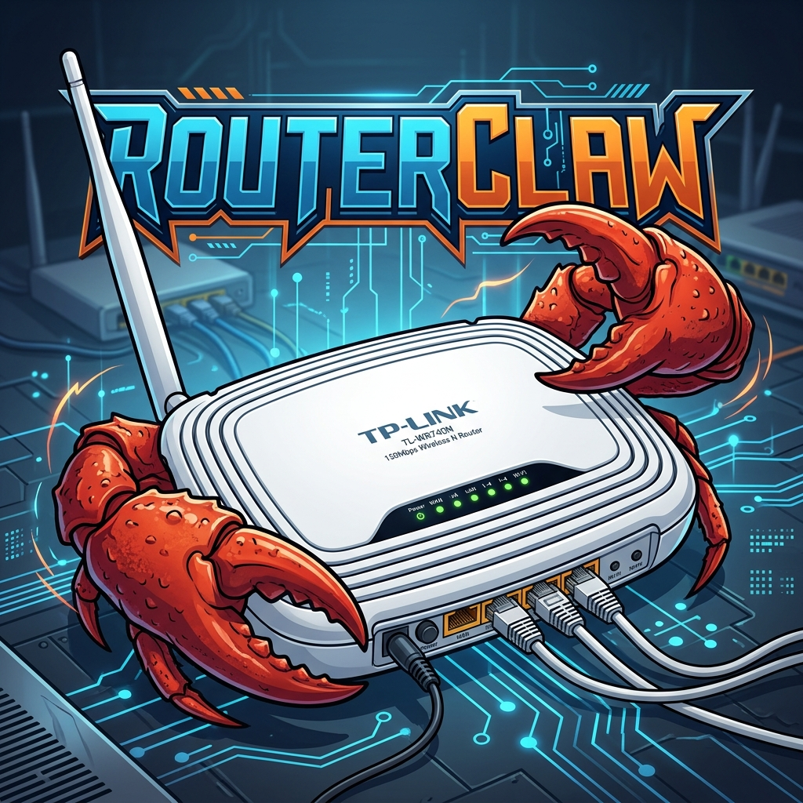

# RouterClaw - OpenWrt Router AI Agent

RouterClaw is a fully autonomous AI agent written in Go, specifically designed to run on resource-constrained embedded systems like OpenWrt routers (e.g., TP-Link WR740N with 32MB RAM / 4MB Flash). It acts as an always-on, intelligent "brain" for your home network.

## Features

- **Autonomous Agentic Loop**: Capable of breaking down complex tasks into sub-tasks, chaining multiple tools, and executing them autonomously until the goal is achieved.
- **Telegram Bot Interface**: Communicate directly with your router via a Telegram bot interface.
- **Google Workspace Integration**: Reads your Gmail, sends emails, checks your Google Calendar, creates events, and deletes events.
- **Web Browsing & Searching**: Can scrape websites, submit web forms, and search the web for real-time information.
- **OpenWrt Shell Execution**: Has direct access to the router's underlying Linux shell (`ash`/`bash`), allowing it to automate network tasks, monitor devices, and write its own scripts.
- **Wake-on-LAN (WoL)**: Can magically wake up computers on your local network on command.
- **Memory & Context**: Maintains conversational memory and state across interactions.

### Screenshots in Action

| Chat Example 1 | Chat Example 2 | Chat Example 3 |
|:---:|:---:|:---:|
|  |  |  |
|  |  |  |


## Architecture

- **Go Binary**: Compiled with `GOOS=linux GOARCH=mips GOMIPS=softfloat` specifically for MIPS architecture routers without hardware floating-point units.
- **Low Footprint**: Designed to run entirely in RAM (`/tmp/tmpfs`) on 32MB systems where flash storage is limited to 4MB.

## Repository Contents

- `*.go`: The core RouterClaw engine (Orchestrator, Telegram Bot, Google Integration, Web, LLM integration, etc.).
- `config.json`: Configuration file storing API keys (DeepSeek, Telegram, Google) and worker node MAC addresses.
- `scripts_pc/`: Helper scripts used on the host PC during deployment:
  - `Arrancar_RouterClaw.bat`: A Windows batch script that automatically cross-compiles the Go binary and SCPs it to the router's RAM (`/tmp`) to restart the agent after a power loss.
  - `restore_net.py`: A Python script to restore the router's network configuration via UART over a Raspberry Pi Pico bridge (useful if the router loses its switch configuration upon reboot).
  - `list_events.py`: A Python debug script to check Google Calendar events.
- `*.py / *.sh`: Various testing and network interaction scripts used during development.

## Setup & Compilation

### 1. Minimal OpenWrt Firmware (4MB Flash Routers)
Because older routers like the TP-Link WR740N only have 4MB of flash storage, the standard OpenWrt firmware includes too many packages (like the LuCI web interface and IPv6) and will not leave enough RAM/Storage to run Go binaries. You must build a custom, stripped-down OpenWrt image and flash it via a serial connection:
1. Download the OpenWrt ImageBuilder for your router's architecture (e.g., `ath79/tiny`).
2. Build a minimal image excluding LuCI and IPv6 to save space:
   ```bash
   make image PROFILE="tplink_tl-wr740n-v4" PACKAGES="-luci -luci-base -ipv6 -odhcp6c -ip6tables"
   ```
3. Because the factory firmware will likely reject this custom image, you must flash it via UART serial pins:
   - Solder headers to the TX, RX, and GND pins on the router's motherboard.
   - Connect via a USB-to-TTL serial adapter (or a bridged Raspberry Pi Pico).
   - Interrupt the bootloader (U-Boot) by typing `tpl` during boot.
   - Set up a TFTP server on your PC and transfer the `openwrt-sysupgrade.bin` directly into the router's memory, then flash it using `erase` and `cp.b` commands.

### 2. RouterClaw Agent Configuration
1. Configure your `config.json` with the appropriate API keys.
2. Compile the binary for MIPS:
   ```bash
   env GO111MODULE=on GOOS=linux GOARCH=mips GOMIPS=softfloat go build -trimpath -ldflags '-s -w' -o routerclaw .
   ```
3. Transfer the binary to the router (ideally to `/tmp/` due to flash constraints):
   ```bash
   scp routerclaw root@192.168.1.2:/tmp/
   ```
4. Run it in the background:
   ```bash
   cd /tmp && ./routerclaw /root/config.json &
   ```

## Disclaimer
RouterClaw was built as an experimental, autonomous AI. It has the ability to execute arbitrary shell commands on its host system. Protections have been added to prevent it from accidentally rebooting the router, but use with caution on production networks!
